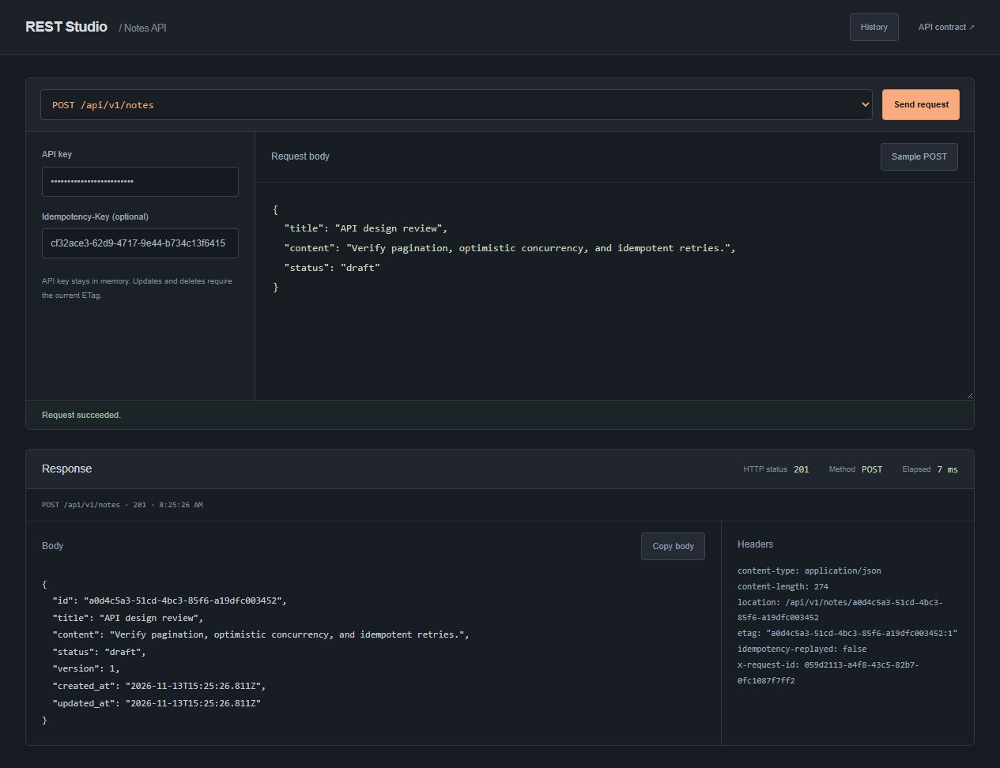

# REST Studio

Explore a versioned Notes API with ETags, conditional reads, idempotency, and OpenAPI.



## Run

Requires Python 3.11+; no third-party runtime dependencies. Clone this repository and run from its root:

```sh
python run.py
```

Open http://127.0.0.1:8000/. Use `python run.py --port 8001` to run alongside another app.
For REST requests, configure a session key before launching (PowerShell):

```powershell
$env:PORTFOLIO_API_KEY = python -c "import secrets; print(secrets.token_urlsafe(32))"
Set-Clipboard $env:PORTFOLIO_API_KEY
python run.py
```

Paste the key into the request builder. `/openapi.json` documents the contract.

SQLite state lives in `data/rest-studio.db` and is ignored by Git. `--database /path/to/app.db` selects another database. Uploaded analysis input is processed in memory. No other repository or shared service is required.

## Interface

The request bar selects an endpoint and sends the request. Authentication, filters, and conditional headers sit beside the JSON editor. Responses show their status, body, and headers together. Session history and collection import/export open in a separate dialog; preparing a historical request closes the dialog without sending it. On narrow screens, request settings and response headers stack beneath their related controls.

The interface uses its own stylesheet and does not load the original shared identity or animation scripts.

## API example

`examples/request.json` contains a fictional request body and its endpoint. Browser analysis requests use `Content-Type: application/json` and `X-Portfolio-Client: browser`; Notes requests use `X-API-Key`. All routes are local to this app.

## Architecture

The browser uses plain JavaScript and CSS, a loopback Python HTTP server validates requests, and domain functions produce the reports or transactional writes. `portfolio/` is the retained internal Python package name; this repository serves only **REST Studio**. Its database contains only this app's tables. Shared validation, CSV helpers, and visual utilities have local copies, so changes can be released independently.

## Verify

```sh
python -m unittest discover -s tests -v
python check_js.py
node --test
```

Node.js 22+ is used for frontend checks only. GitHub Actions tests Linux on Python 3.11–3.13 and Windows on Python 3.13.

## Scope

Designed as a local portfolio/demo application. The standard-library server is not a production internet deployment. Notes routes require the configured shared API key; this is not multi-user authorization.

## Source provenance

Extracted from [Portfolio Lab](https://github.com/Michaelhoang8/portfolio-lab) at commit `ce14f2cf297c6dfbd5895b9138626b7e69530ec0`. The original repository retains the genuine development history. This repository begins with the standalone extraction; history has not been backdated. Runtime databases and credentials were not copied.
